# PhoneKB

**手机当键盘用 —— 把 Android 手机变成蓝牙键盘 / 触控板 / 媒体遥控器 / 游戏手柄，平板和电脑零安装、免 root。**

纯蓝牙 HID：被控端不装任何 App，手机端一个 APK 就是全部。

[](https://github.com/linxun314/phonekb/releases/latest)
[](https://github.com/linxun314/phonekb/releases)
[](https://github.com/linxun314/phonekb/actions)
[](LICENSE)
[](#兼容性)

> Turn your Android phone into a Bluetooth HID keyboard / trackpad / media remote / gamepad — the host device needs **zero installation and no root**.

实测组合：**Redmi K40（Android 13 / HyperOS）→ iQOO Pad2（Android 14）**。平板只做一次蓝牙配对，之后打开手机 App 就能用。

**[⬇️ 下载最新版](https://github.com/linxun314/phonekb/releases/latest)** · [快速开始](#快速开始) · [功能](#功能) · [截图](#截图) · [常见问题](#常见问题) · [文档](#文档)

---

## 当前版本 v0.37.8

这一版新增 / 打磨的内容（README 只介绍当前版本，旧版本说明不保留）：

- **电脑上玩「只认 Xbox 手柄」的游戏（奥日等）有了官方解释（v0.37.8）**：Windows 只把手机当「通用 HID 游戏控制器」（DirectInput），而奥日、绝大多数 3A 只枚举 **XInput（Xbox）** 设备，所以游戏里根本列不出这个手柄 —— 不是按键没发出去，是协议差异，App 侧改不了。用 **Steam 中转**即可：Steam → 设置 → 控制器 → 打开「通用手柄配置支持」→ 通用手柄「测试设备」里按键确认 → 右键游戏 → 属性 → 控制器 →「启用 Steam 输入」；这套说明已写进 App 帮助和 `docs/使用说明.md`（本版只有文案与文档变化）
- **已连接的那台可以「断开」（v0.37.7）**：设备列表里只有真连着的那一行多一个红色「断开」按钮，点一下断开、并且**暂停一切自动重连**（自动重连 / 冷启动回连 / 抢连守护），那一行立刻变回「切换」随时连回来；点「切换」或重启 App 后自动重连恢复
- **顶栏重排（v0.37.6）**：电源键右边的 **「设备」** 换成带手机图标的蓝描边大按钮；**「平板」「电脑」折成一个按钮**（按钮上写当前模式，点开是两项菜单）；**「旋转」从「更多」里拿出来**一直露在页签行右端；**删掉「单手」页签**（页签固定 5 个）；设备列表的类型角标换成手机 / 显示器 / 电视线稿图标
- **电脑模式：手机现在也能当 Windows 电脑的键盘**。顶栏的「平板 / 电脑」折叠按钮，电脑模式走**同一条蓝牙 HID 通道** —— Windows 10 / 11 自带蓝牙键鼠驱动，**电脑端不用装任何软件**
- 电脑模式的键盘快捷键条换成 Windows 常用键：Ctrl+C / Ctrl+V / **Win** / **Win+D** / Alt+Tab / **截屏（Win+Shift+S）** / **锁屏（Win+L）**；媒体页常用键换成 **截屏 / 任务视图（Win+Tab）/ 锁屏 / 菜单（Shift+F10）** + 音量与播放键
- 触控板、滚轮、鼠标左中右键、手柄在电脑模式下完全一样（Windows 认成标准 HID 键鼠 + HID 游戏控制器），状态栏会显示「平板模式 / 电脑模式」和电脑名，配对弹窗按模式给不同步骤
- **竖屏拉伸条**：竖屏键盘页可以在快捷键条与键盘之间拖动分隔条调键盘高度，触控板页 / 媒体页拖动顶部分隔条调功能区高度，双击恢复默认
- **断开后不再无限重连**（v0.37.1）：最多重试 8 次（3 s 起、每次 +3 s、封顶 30 s），失败就明确写「连不上平板 / 平板没有响应」，点状态文字立刻重试；冷启动会自动连回上次那台设备，配对被删时直接提示重新配对
- **设备切换：不用再取消配对就能换机器**（v0.37.5）。顶栏电源键右边的 **「设备」** 打开已保存设备列表（手机 / 显示器图标 + 名称 + 上次连接时间），点「切换」就断开当前、连上目标，约 1–2 秒；已配对过的设备不需要重新配对。「更多设置 → 设备抢连守护」默认开：切到电脑后平板自己连回来会自动切回电脑。注意 Android 的 HID 外设同时只能连一台主机，这是「一键切换」不是「同时连两台」
- **触控板更跟手了**（v0.37.4）：以前两帧间隔 ≥2 ms 就发一份报文，手指快划时一秒发四五百份，而蓝牙 HID 通道大约只吃 90 份/秒 —— 多的全在栈里排队，光标越滑越落后。现在按节奏发（默认 9 ms ≈ 111 份/秒，领先边缘立刻发、中间移动合并不丢步），「更多设置 → 指针上报节奏」可选 `2 / 6 / 9 / 12 ms`，延迟弹窗还会显示实际「节奏 N 份/秒」
- **手柄在 Windows 上「某个键一直亮」修好了**（v0.37.2）：十字键的方向位以前混进了按钮字段（Windows 按顺序数按钮，于是变成「按钮 1–4」），加上复位报文长度不对、离开手柄页不发归零 —— 现在方向只走 hat、复位发完整报文，离开手柄页 / 切页面 / 进后台都会自动全松
- 版本：手机端 **0.37.8**（versionCode 68）；安装包 493 KB

## 30 秒了解

| 你想要的 | PhoneKB 怎么做 |
|---|---|
| 用手机给平板打字、按快捷键 | 手机注册成**标准蓝牙键盘**，平板把它当普通蓝牙键盘用，**平板不装 App** |
| 用手机当鼠标 | 触控板 + 物理左/中/右键，支持点击、拖动、双指滚动、右键菜单，速度可调（含加速度） |
| 躺床上刷视频、拖进度、切歌、调音量、调亮度、截屏 | 媒体页：上一段 / 播放暂停 / 下一段、−10s / ＋10s 快退·快进（可按住连发）、音量 ± / 静音 / 亮度 −/＋ / 截屏 / 多任务 / 返回主页菜单 |
| 用手机控制 Windows 电脑 | 顶栏切到**电脑模式**：同一套蓝牙 HID，Windows 免安装就认成键盘 + 鼠标 + 手柄，配 Win / Win+D / Win+Shift+S / Win+L 等常用组合 |
| 手机当手柄玩模拟器 | 手柄页：浮键 / Xbox 式皮肤 / 自定义三种布局，移动盘（十字键 / 圆盘 / 模拟摇杆）+ ABXY + L1/R1/LT/RT + SELECT/START + 双模拟摇杆，大小可分别无级调节 |

| 键盘 | 触控板 |
|---|---|
|  |  |

## 功能

- **蓝牙 HID，一装一配**：手机端一个 APK，被控端只需蓝牙配对，不装软件、不 root
- **电脑模式**：顶栏「平板 / 电脑」折叠按钮一键切换被控设备。电脑模式走同一条蓝牙 HID，Windows 免安装；键盘快捷键条变成 Win / Win+D / Alt+Tab / Win+Shift+S 截屏 / Win+L 锁屏，媒体页常用键变成 截屏 / 任务视图 / 锁屏 / 菜单（Shift+F10），其余页面行为不变
- **键盘**：手机布局 / 电脑布局两套，含符号页、Ctrl+C/V/X/A、Alt+Tab、方向键
- **触控板**：单指移动 · 点击左键 · 双指滚动 · 双指点击右键 · 三指中键；底部左/中/右键可长按拖动；右侧滚动列；一键弹出浮层数字键盘 / 浮层键盘 / 浮层触控板
- **指针灵敏度**：0.4×–2.5× 无极滑块 + 慢/标准/快预设 + 加速度开关 + 滚轮 1–6 行，四处触控面统一生效
- **媒体键**：媒体卡 **⏮ 上一段 / ⏯ 播放暂停 / ⏭ 下一段**（按住连发）+ 两颗宽键 **−10s / ＋10s**，发 ← / → 方向键，点一次退 / 进 10 秒、按住连续快退·快进；功能键卡两排 5 个圆键：音量 + / 音量 − / 静音 / 截屏 / 多任务、亮度 − / 亮度 + / 返回 / 主页 / 菜单
- **触控延迟优化**：一帧历史采样全累加、合并窗口 2 ms、极速模式（移动中不重绘不震动）、点击方式「抬手 / 按下即点」、长按拖拽 250/350/450 ms 可调；「更多设置」里可读指针延迟 p50/p95（实测 age p50=8 ms / p95=10 ms，App 侧发送成本 p50=2 ms）
- **游戏手柄**
  - 三种布局：**浮键**（左下移动盘、右下 X/Y/A/B、两侧肩键、顶部 SELECT/START，中间留空不挡画面）/ **皮肤**（整块 Xbox 式机身 + 白色圆环 + 双摇杆）/ **自定义**（任何按键都能拖，横竖屏各存一套）
  - 移动盘三种形态：**十字键** / **圆盘**（按住滑动选 8 方向、扇区高亮、松手回中）/ **摇杆**（真模拟摇杆，摇杆头跟手，输出 X/Y 轴；可开「摇杆同时发方向键」兼容只认方向键的老模拟器）
  - 大小：**移动盘** 与 **按键（ABXY / 肩键 / 菜单键）** 各一个 **60%–200%** 无级滑块，滑块下方显示「本屏实际 N%」（屏幕放不下时如实钳制），立即生效并记忆
  - **大键模式**：隐藏肩键 / 摇杆 / 菜单键，只留方向盘与 ABXY —— 横屏左右贴边、竖屏上下竖排，按键可放到接近满屏
  - 右摇杆轴向可选 **RX/RY** 或 **Z/RZ**（选 Z/RZ 需在平板上忘记设备后重新配对一次）
  - 输入：ABXY + L1/R1/LT/RT + SELECT/START + **L/R 模拟摇杆**（四轴），支持多指同时按
  - 触控板：中间空白可当触控板（关 / 中间面板 / 整片空白），手势与触控板页一致，可选「只移动」不点击；另有可拖动位置的触控板浮层（带 返回/主页/后台），左半屏按键照常可用
  - 排错：设置里有「方向键方向 · 修正一格」开关，旧配对导致方向整体偏一格时可临时纠正；震动反馈可关
- **双手模式**：左侧触控区 + 右侧按键板，页签行右端的「互换」一键对调左右/上下并记忆
- **设备切换**：顶栏「设备」列出已保存的主机（手机 / 显示器 / 电视图标区分类型），点「切换」就断开当前、连上目标，已配对设备无需重新配对；「设备抢连守护」默认开
- **横竖屏自适应**：横屏紧凑工具栏 + 沉浸全屏；「旋转」键常驻页签行，强制横/竖屏（长按恢复跟随系统）
- **自适应界面**：以 393dp 为基准按屏幕宽度与系统字体缩放，顶栏实在放不下时才把帮助等收进「更多」（「旋转」始终在页签行）；帮助 →「界面大小」可选 自动 / 小 / 标准 / 大
- **比例可调**：键盘页（触控区 / 键盘）、触控板页与媒体页（功能区 / 留空区）都能拖动调节、双击复位并记忆
- **稳定连接**：前台服务保活、HID 断连自动重新注册、内置配对引导与排错帮助

## 一条通道：蓝牙 HID

```
        ┌────────────────────────────┐
        │     平板 / 电脑 / TV        │
        │    （被控端，零安装、免 root）│
        └──────────▲─────────────────┘
             蓝牙 HID 键鼠 / 媒体 / 手柄
        ┌──────────┴─────────────────┐
        │        Android 手机         │
        │          PhoneKB            │
        └────────────────────────────┘
```

手机把自己注册成**标准蓝牙键盘 + 鼠标 + 媒体控制器 + 手柄**，被控端系统直接认成外设，所以：

- **不需要** 在被控端装 App、开调试、给权限，也不需要 root
- **不需要** 连同一个 WiFi，纯蓝牙即可
- 中文输入用被控端自己的输入法（外接键盘的身份，任何输入法都正常）

## 截图

**电脑模式（控制 Windows 电脑）**

| 键盘（Win 快捷键条） | 媒体（截屏 / 任务视图 / 锁屏） | 触控板 |
|---|---|---|
| 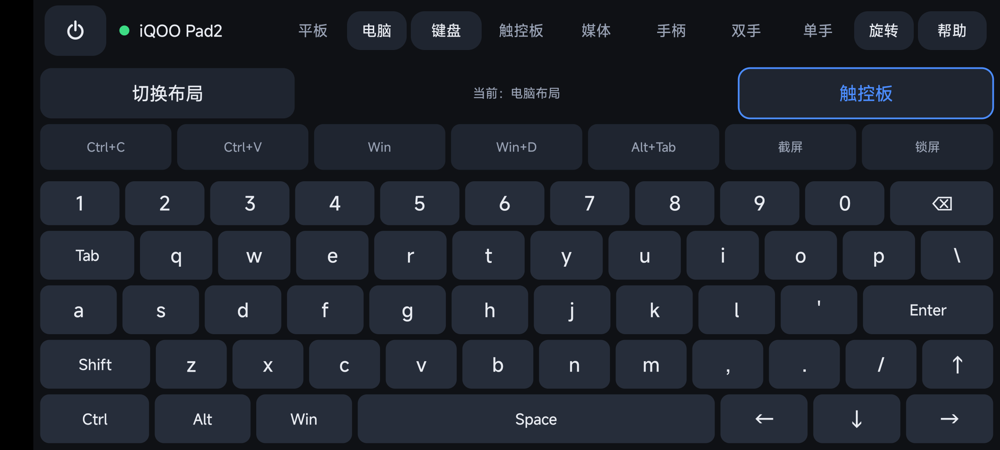 | 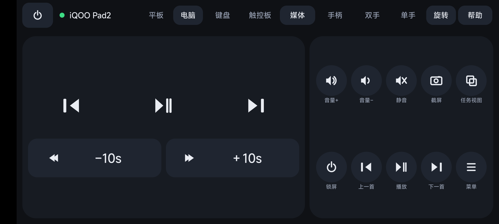 | 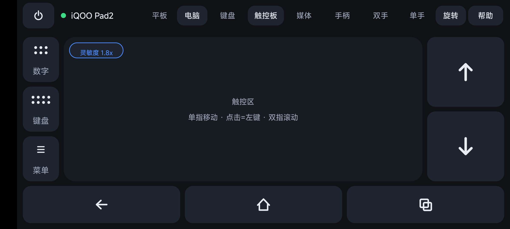 |

| 竖屏键盘（电脑模式） | 电脑模式 · 竖屏触控板 | 电脑模式 · 手柄 |
|---|---|---|
| 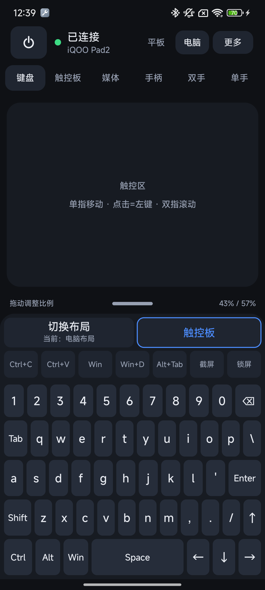 | 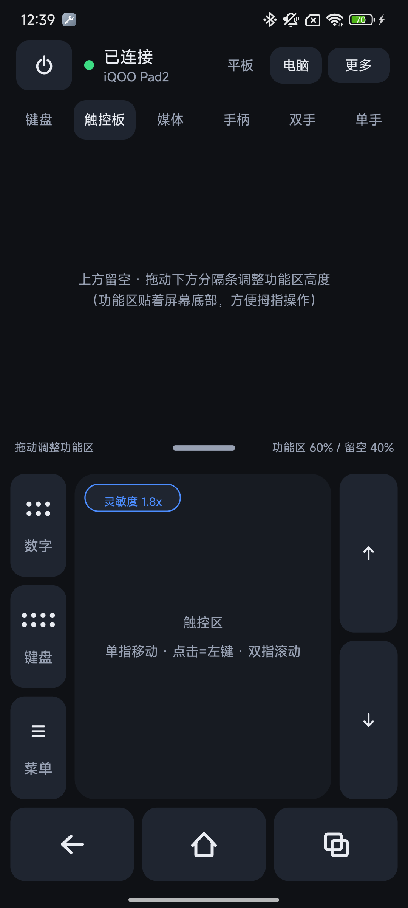 | 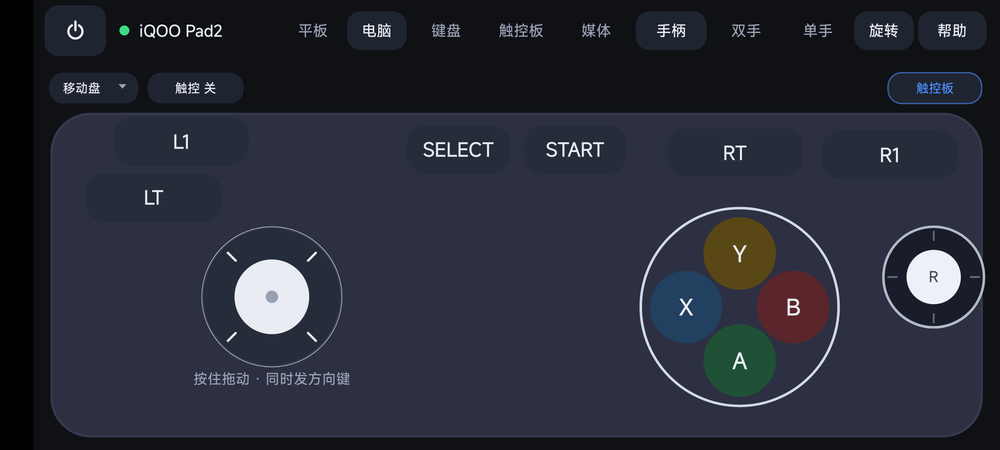 |

**设备切换（换平板 / 电脑不用重新配对，类型用图标显示）**

| 竖屏 · 设备列表（底部面板） | 横屏 · 设备列表（居中卡片） |
|---|---|
| 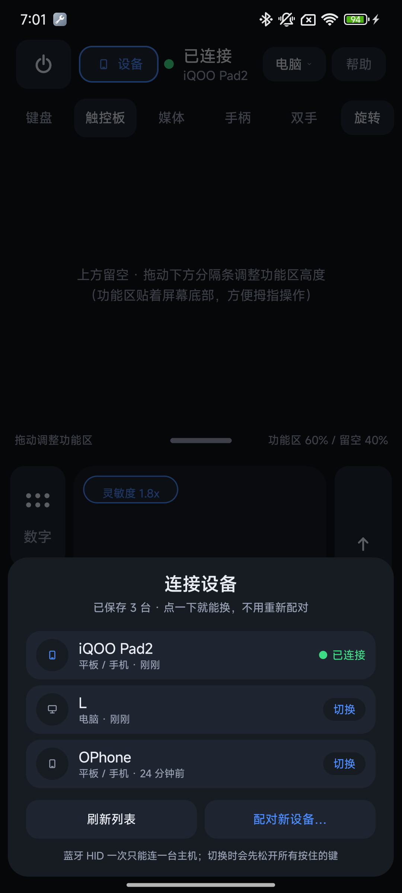 | 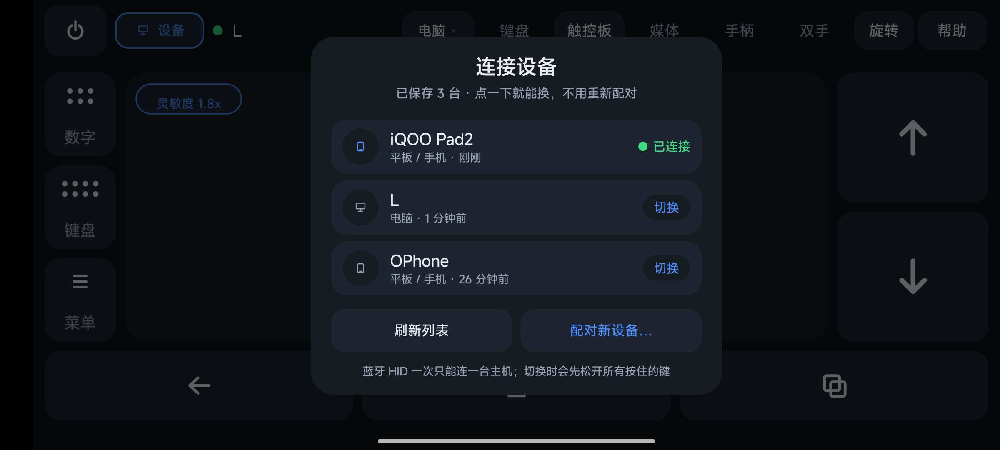 |

**当前连着的那一行多一个「断开」（v0.37.7）**

| 已连接（右侧红色「断开」） | 断开之后（都变回「切换」） |
|---|---|
| 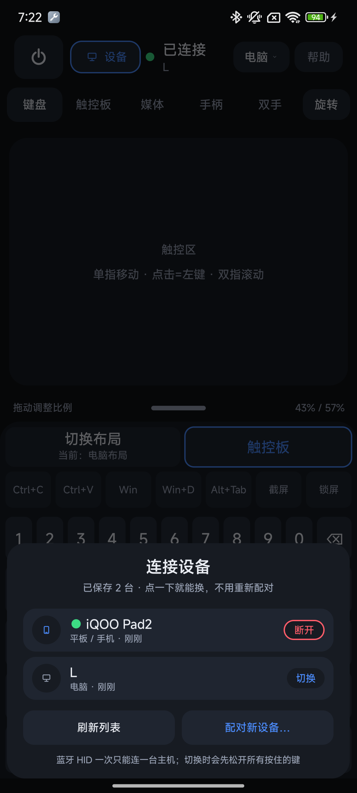 | 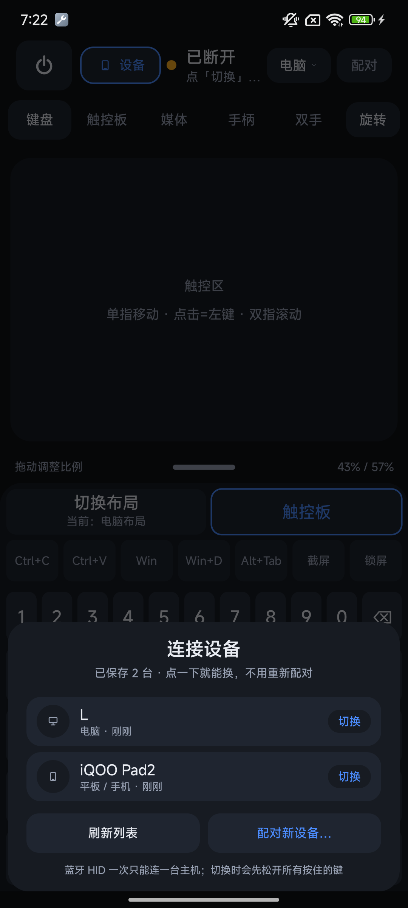 |

| 键盘（电脑布局） | 键盘（手机布局） | 数字键盘浮层 |
|---|---|---|
|  |  |  |

| 媒体 | 手柄（皮肤布局） | 双手模式 |
|---|---|---|
|  |  |  |

| 手柄（竖屏皮肤） | 手柄设置 | 数字键盘 / 触控板浮层 |
|---|---|---|
| 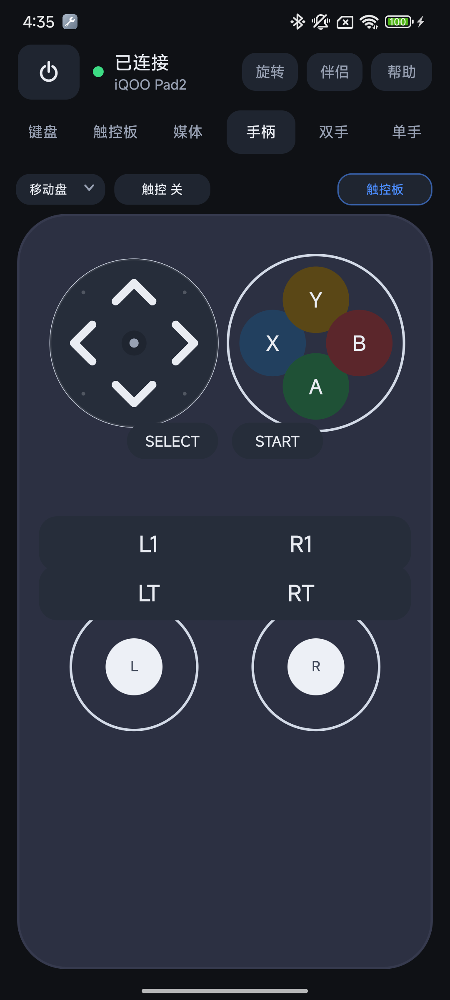 | 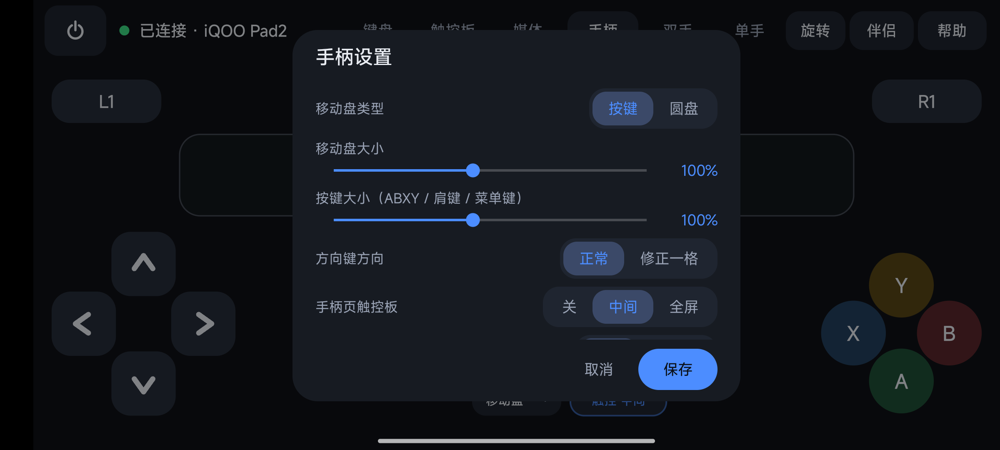 | 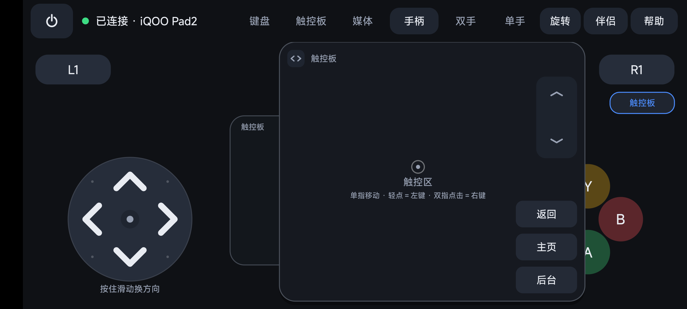 |

| 竖屏顶栏（设备 / 模式 / 旋转） | 横屏顶栏（同一套） | 平板 / 电脑折叠菜单 |
|---|---|---|---|
| 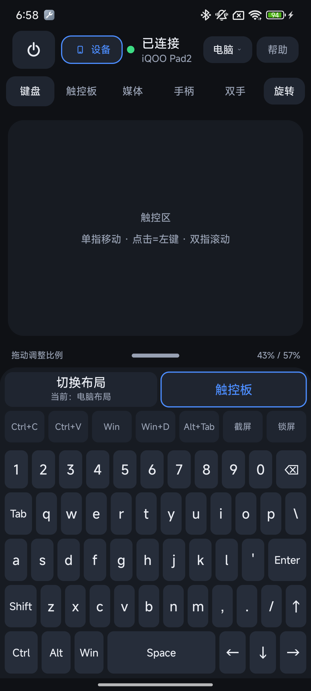 | 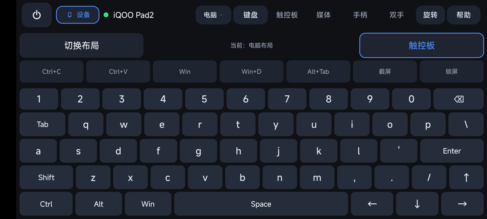 | 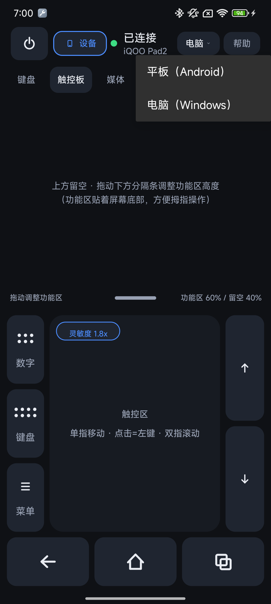 |

| 竖屏键盘 | 指针灵敏度入口 | 指针灵敏度设置 |
|---|---|---|
|  | 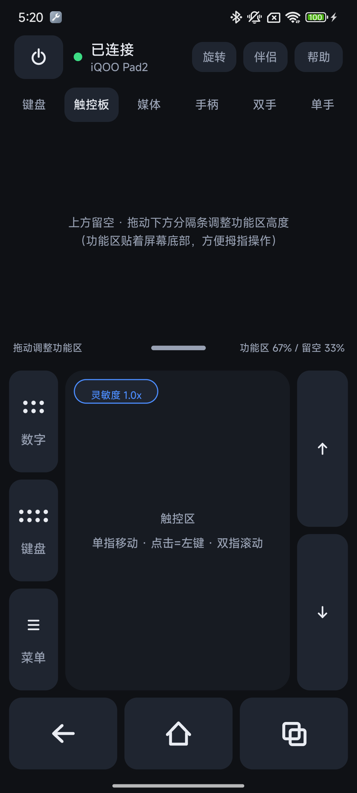 | 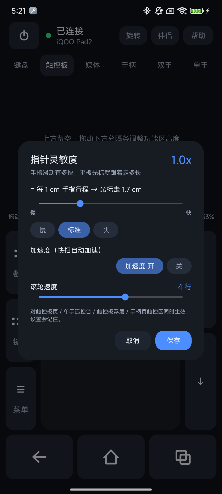 |

| 竖屏触控板 | 界面大小 | 手柄（浮键 · 竖屏） |
|---|---|---|
|  | 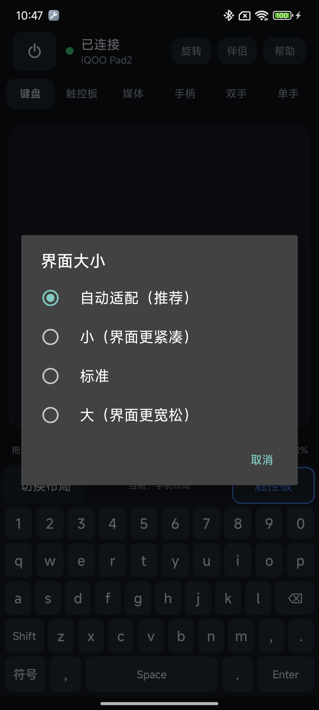 | 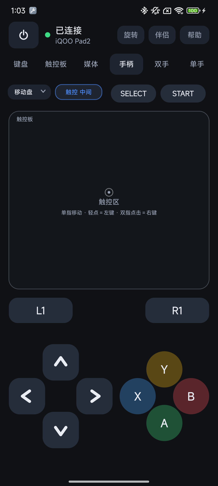 |

更多截图见 [docs/screenshots/](docs/screenshots/)。

## 下载与安装

从 [Releases](https://github.com/linxun314/phonekb/releases/latest) 下载：

| 文件 | 装在哪 | 说明 |
|---|---|---|
| `PhoneKB-0.37.8.apk` | **手机** | 全部键鼠 / 媒体 / 手柄功能，一个 APK 就是全部 |

安装提示：Android 13+ 首次安装需允许「此来源的应用」；首次运行请允许通知权限（前台服务保活，否则后台会被系统回收导致蓝牙断开）。

## 快速开始

1. **手机装 PhoneKB 并打开**，顶部状态显示「等待配对 / 已连接」
2. **点右上角「配对」**，按提示让手机蓝牙处于可被发现状态
3. **在被控设备上配对**：打开平板/电脑的蓝牙设置 → 搜索手机蓝牙名称 → 配对（Windows：设置 → 蓝牙和其他设备 → 添加设备 → 蓝牙）；回到 App 看到「**已连接 · 设备名**」即可使用
   - 控制 Windows 时先在顶栏点那个写着「**平板 ⌄ / 电脑 ⌄**」的按钮选「电脑（Windows）」，控制平板/手机选「平板（Android）」，选择会被记住

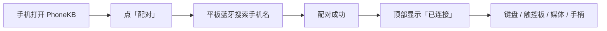

**连上了但按键没反应？** 在手机蓝牙设置里删掉该设备的配对，再从 App 的配对引导重新走一次（HID 需要正确的配对流程）。换了新版本如果手柄摇杆 / LT / RT 没反应，同样需要「忘记设备 → 重新配对」一次（HID 报告描述符更新过）。更多排错见 [docs/使用说明.md](docs/使用说明.md)。

**应用被系统杀掉后平板不自动重连？** 杀掉 App 等于注销了 HID 外设，平板只会在已配对列表里保留记录、不会自动把「输入设备」连回来。回到 App 后到平板蓝牙里点一下这台手机即可（必要时「取消配对」再重新配对一次）。

## 手势与快捷键速查

| 触控板 | 操作 |
|---|---|
| 移动光标 | 单指滑动（速度可在左上角「灵敏度」里调） |
| 左键 | 单指点击 |
| 右键 | 双指点击 |
| 中键 | 三指点击 |
| 滚动 | 双指上下滑动，或按住右侧 ↑/↓ |
| 拖拽 | 按住底部「左键」再用触控区移动 |

| 键盘 | 说明 |
|---|---|
| 切换布局 | 顶部「切换布局」：手机布局 / 电脑布局 |
| 符号 | 手机布局左下角「符号」页，`ABC` 返回 |
| 快捷键 | Ctrl+C / Ctrl+V / Ctrl+X / Ctrl+A / Alt+Tab 专用键 |
| 浮层键盘 / 数字键盘 | 触控板页左侧「键盘」「数字」按钮随时呼出 |

| 手柄 | 说明 |
|---|---|
| 换布局 / 大小 / 类型 | 左上「移动盘」→ 手柄设置，或右上齿轮 |
| 拖动按键位置 | 设置里「编辑布局」，或长按空白约 3 秒；顶部「重置 / 完成」 |
| 中间当触控板 | 顶部「触控」小键切 关 / 中间 / 全屏；黑底浮层可拖动位置 |

## 兼容性

| 角色 | 要求 |
|---|---|
| 手机（控制端） | Android 9（API 28）及以上；系统保留 **Bluetooth HID Device profile**（少数厂商 ROM 会屏蔽，App 会检测并提示） |
| 被控端 | 支持蓝牙键盘/鼠标的设备：Android 平板/手机、Windows、macOS、Linux；iPadOS 13+ 理论支持（未实测） |
| 界面适配 | 以 393dp 为基准自动缩放，约 320–480dp 宽度、系统字体 0.85–1.3 倍下均可用 |

## 为什么不用投屏 / 远程桌面？

| 方案 | 延迟 | 被控端安装 | 能打字/用快捷键 | 适合场景 |
|---|---|---|---|---|
| **PhoneKB（蓝牙 HID）** | 极低（HID 事件） | **不需要** | 系统级键盘，任何 App 都能输入 | 打字、快捷操作、演示、躺床操作 |
| scrcpy / 无线投屏 | 中（视频编码） | 需要开 USB/无线调试 | 部分 | 需要看屏幕、精细操作 |
| 远程桌面类 App | 较高 | 两端都装 | 部分 | 完整桌面操控 |

PhoneKB 不传输画面，只把手机当外设，所以延迟低、被控端干净；需要看屏幕时仍可配合投屏使用。

## 隐私与权限

- 手机端权限：只有 **蓝牙**（HID 必需）和 **通知**（前台服务保活）；不需要网络、存储、通讯录、位置、麦克风、相机
- 没有服务器、没有账号，不采集也不上传任何数据，所有配置只保存在本机 SharedPreferences

## 构建

### Gradle（Android Studio 用户）

```bash
./gradlew assembleDebug        # Windows: gradlew.bat assembleDebug
```

产物：`app/build/outputs/apk/debug/app-debug.apk`。需要 JDK 17+、Android SDK Platform 36。

### 命令行（不装 Android Studio，Windows）

```powershell
powershell -ExecutionPolicy Bypass -File tools/build.ps1 -Clean -VersionName 0.37.8 -VersionCode 68
```

脚本直接调用 `aapt2 → javac → d8 → zipalign → apksigner`，产物在 `build/`。设备没有 adb 时，可用 `node tools/serve-apk.js` 起一个局域网下载页（端口 8000）。

### GitHub Actions

仓库自带 CI（[build.yml](.github/workflows/build.yml)），push / PR 自动构建 debug APK 并上传 Artifacts。发布流程见 [docs/发布指南.md](docs/发布指南.md)。

## 项目结构

```
app/src/main/java/com/phonekb/          手机端
  MainActivity.java      页面框架、顶栏、浮层、设置记忆
  HidManager.java        BluetoothHidDevice 封装：注册、连接、报文发送
  HidConstants.java      HID Report Descriptor 与键值常量
  KeyboardView.java      键盘页（两套布局 + 符号页）
  TouchpadView.java      触控板页（手势 / 滚动 / 按键）
  PadController.java     触控板手势判定
  ControlPadView.java    浮层数字键盘 / 键盘 / 触控板（含灵敏度入口）
  MediaView.java         媒体页
  GamepadView.java       手柄页（三布局 / 圆盘 / 摇杆 / 编辑 / 触控板）
  TwoHandView.java       双手模式
  PointerSettings.java   指针灵敏度 / 滚轮 / 加速度设置
  SensitivityDialog.java 指针灵敏度弹窗
  KeepAliveService.java  前台保活服务
  ChromeBar.java / Ui.java / Icons.java  顶栏折叠、自适应尺寸、自绘图标
  IconView.java          小图标 View（设备类型角标、模式按钮的 ⌄ 等）
tools/build.ps1          无 IDE 构建脚本
tools/serve-apk.js       局域网 APK 下载页
docs/                    文档与截图
```

## 技术实现

- 手机端用 `BluetoothHidDevice`（API 28+）注册复合 HID 设备，一个 Report Descriptor 内 4 个 Report ID：
  - 键盘：8 字节，6KRO + 修饰键
  - 鼠标：按键 + 相对位移 + 滚轮
  - Consumer Control：16 位 usage（媒体、音量、亮度、浏览器/主页/返回等）
  - Gamepad：hat + 16 个按键 + 4 个轴（X / Y / Rx / Ry，-127..127，摇杆用）
- 全部 UI 为自绘 `View`（Canvas），蓝牙功能**无第三方依赖**（连 jar 都没有）；自适应缩放、顶栏折叠也由自绘逻辑完成
- 手势统一走 `PadController`；指针位移 = 手指数 × 1.7（基准）× 灵敏度，开启加速度时快扫最多再 ×1.9
- 手柄低延迟：HID 报告在专用线程发送、鼠标/摇杆移动 4ms 合并上报（≈250Hz）
- 前台服务保活，避免 Activity 被回收导致 HID 静默注销；注册失败自动重试

## 已知限制

- **中文输入**：蓝牙 HID 只发键码，汉字由被控端自己的输入法完成（手机端不做语音/上传，这也是 v0.36.0 移除 WiFi 伴侣后的取舍）
- **光标外观**：光标由被控端系统绘制，蓝牙鼠标只能发相对位移，无法改形状/大小；可在平板「辅助功能 / 鼠标」里调指针大小
- **亮度键**：多数 Android 平板/电视盒子响应 Consumer 亮度 usage，iQOO / vivo 等部分平板会完全忽略（属于被控端行为，App 无法绕过）
- **截屏 / 多任务**：走 PrintScreen / Alt+Tab，最终由系统决定，个别 App 可能拦截
- 少数手机 ROM 禁用 HID Device profile，只能当主机用
- 同一时间只能有一个 App 注册 HID 外设，装了其它 HID 类 App 需先停用
- 旧配对缓存会保留旧的 HID 描述符：新增摇杆 / LT / RT 后需「忘记设备 → 重新配对」一次

## 常见问题

**Q：平板需要 root 吗？手机需要 root 吗？**
A：都不需要。被控端甚至不需要装 App。

**Q：为什么平板打不出中文？**
A：蓝牙键盘只能发送键码（和外接键盘一样），平板不会把手机上的拼音变成汉字。改用平板自己的输入法即可：拼音、语音、手写都能用，键盘照常打字。

**Q：手机和平板需要连同一个 WiFi 吗？**
A：不需要。PhoneKB 只走蓝牙 HID。

**Q：手柄摇杆 / LT / RT 没反应？**
A：这几项是后加的，HID 描述符变了，需要在平板蓝牙设置里「忘记设备」，再从 App 重新配对一次。

**Q：电脑连上了，但奥日这类游戏里根本找不到手柄？**
A：Windows 只把它认成「通用 HID 游戏控制器」（DirectInput），而这些游戏只枚举 **XInput（Xbox）** 设备 —— 协议差异，App 改不了。用 Steam 输入中转：Steam → 设置 → 控制器 → 打开「通用手柄配置支持」→ 在「通用手柄 → 测试设备」里按手机上的键确认 Steam 收到 → 右键游戏 → 属性 → 控制器 →「启用 Steam 输入」；非 Steam 游戏先「添加非 Steam 游戏到我的库」。手边有真 Xbox 手柄的话，玩奥日直接用真手柄最省事。

**Q：手柄方向键整体偏一格 / 按左出下？**
A：旧配对缓存的旧描述符导致。重新配对可根治；不想重配可在 手柄设置 →「方向键方向」改成「修正一格」。

**Q：能控制 iPhone / iPad 吗？**
A：iPadOS 13+ 支持蓝牙键盘鼠标，理论上可配对使用（本仓库主要在 Android 平板实测，Apple 设备未实测）。

**Q：能反向，用平板控制手机吗？**
A：不能。PhoneKB 的方向固定：手机是外设，被控端是主机。

**Q：一次能连几台设备？**
A：HID 同一时间只保持一条连接；换设备时在系统蓝牙里切换即可，配对关系会保留。

**Q：为什么不用 scrcpy 那种方案？**
A：那是「投屏 + 注入」，需要被控端开调试；PhoneKB 追求被控端零安装、系统级键盘、低延迟。两者可以互补。

## Roadmap

- [x] 媒体页重做（截屏 / 多任务 / ±10s 长按连发）
- [x] 手柄三布局 + 十字键 / 圆盘 / 模拟摇杆
- [ ] HID 绝对触控（数字化仪）模式：触控板 1:1 映射平板屏幕，点哪打哪
- [ ] USB 通道（ADB 注入）
- [ ] Apple 设备实测（iPadOS）与兼容性说明

## 参与贡献

Issues / PR 都欢迎。提交前请先看 [docs/需求与进展.md](docs/需求与进展.md)（当前能力与待办）与 [docs/使用说明.md](docs/使用说明.md)。

## 文档

| 文档 | 内容 |
|---|---|
| [docs/使用说明.md](docs/使用说明.md) | 完整安装、配对、各页面操作、各平台注意事项、排错、卸载 |
| [docs/调试参数.md](docs/调试参数.md) | `adb am start` 调试参数（切页、模拟窄屏、浮层、灵敏度等） |
| [docs/需求与进展.md](docs/需求与进展.md) | 当前版本的能力清单、限制、待办 |
| [docs/验证记录.md](docs/验证记录.md) | 真机验证记录（Redmi K40 + iQOO Pad2） |
| [docs/发布指南.md](docs/发布指南.md) | 建仓库、构建、打 tag、发布 Release |
| [CHANGELOG.md](CHANGELOG.md) | 当前版本更新说明 |

## 致谢

实现前调研并参考了这些开源项目的行为与思路（**本仓库代码为独立实现，未复制任何 GPL/AGPL 代码**）：

- [jqssun/android-bt-remote](https://github.com/jqssun/android-bt-remote)（GPLv3，界面/交互参考）
- [arnav-kr/Bluke](https://github.com/arnav-kr/Bluke)（AGPLv3）
- [raghavk92/Kontroller](https://github.com/raghavk92/Kontroller)
- [darusc/Mousedroid](https://github.com/darusc/Mousedroid)

## License

[Apache-2.0](LICENSE) © linxun314

---

如果这个项目对你有用，欢迎点一个 ⭐ Star，让更多人看到。
