# PhoneKB

**手机当键盘用 —— 把 Android 手机变成蓝牙键盘 / 触控板 / 媒体遥控器 / 游戏手柄，平板和电脑零安装、免 root。**

再配一个可选的 **WiFi 伴侣**，解决蓝牙 HID 打不出中文、剪贴板不同步的问题。

[](https://github.com/linxun314/phonekb/releases/latest)
[](https://github.com/linxun314/phonekb/releases)
[](https://github.com/linxun314/phonekb/actions)
[](LICENSE)
[](#兼容性)

> Turn your Android phone into a Bluetooth HID keyboard / trackpad / media remote / gamepad — the host device needs **zero installation and no root**.
> An optional WiFi companion app adds Chinese text input and two-way clipboard sync.

实测组合：**Redmi K40（Android 13 / HyperOS）→ iQOO Pad2（Android 14）**。平板只做一次蓝牙配对，之后打开手机 App 就能用。

**[⬇️ 下载最新版](https://github.com/linxun314/phonekb/releases/latest)** · [快速开始](#快速开始) · [功能](#功能) · [截图](#截图) · [常见问题](#常见问题) · [文档](#文档)

---

## 30 秒了解

| 你想要的 | PhoneKB 怎么做 |
|---|---|
| 用手机给平板打字、按快捷键 | 手机注册成**标准蓝牙键盘**，平板把它当普通蓝牙键盘用，**平板不装 App** |
| 用手机当鼠标 | 触控板 + 物理左/中/右键，支持点击、拖动、双指滚动、右键菜单 |
| 躺床上刷视频、切歌、调音量 | 媒体页：上一首 / 播放暂停 / 下一首 / 音量 ± / 静音 / CC / 返回主页菜单电源 |
| 手机当手柄玩模拟器 | 手柄页：手机式浮键布局，移动盘（十字键 / 圆盘可切换）+ XYAB + L1/R1 + SELECT/START，移动盘与按键大小可分别无级调节 |
| 平板打中文（HID 的天然短板） | 可选 **WiFi 伴侣**：手机上输入中文 → 直接写进平板当前输入框 |
| 手机复制、平板粘贴 | 可选 **WiFi 伴侣**：剪贴板双向同步 |

| 键盘 | 触控板 |
|---|---|
| 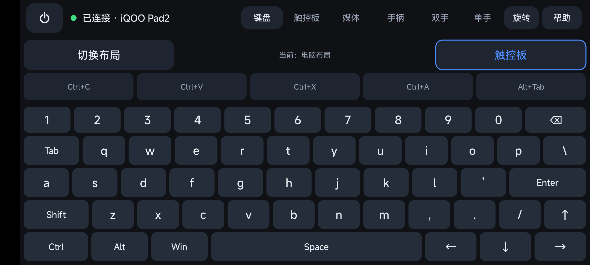 | 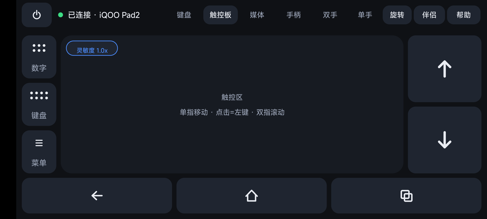 |

## 功能

- **蓝牙 HID，一装一配**：手机端一个 APK，被控端只需蓝牙配对，不装软件、不 root
- **键盘**：手机布局 / 电脑布局两套，含符号页、Ctrl+C/V/X/A、Alt+Tab、方向键
- **触控板**：单指移动 · 点击左键 · 双指滚动 · 双指点击右键 · 三指中键；物理左/中/右键可长按拖动；一键弹出浮层数字键盘 / 浮层键盘
- **媒体键**：媒体条 + 音量 / 静音 / CC / **亮度 −/＋**、返回 / 主页 / 菜单 / 电源（亮度键在 vivo 等不认键码的平板上会走 WiFi 伴侣调系统亮度）
- **游戏手柄**：手机式浮键布局（左下移动盘、右下 X/Y/A/B、两侧 L1/R1、顶部 SELECT/START，中间留空不挡画面），移动盘可切十字键 / 圆盘两种形态，移动盘与按键大小各有 60%–150% 无级滑块并记忆，支持多指同时按
- **双手模式**：左侧触控区 + 右侧按键板，一键「互换」左右/上下位置
- **单手模式**：拇指遥控台 / 拇指键盘，左右手可切换，适合单手握持手机
- **横竖屏自适应**：横屏紧凑工具栏 + 沉浸全屏；顶部「旋转」键强制横/竖屏（长按恢复跟随系统）
- **自适应界面**：按屏幕宽度和系统字体自动缩放，顶栏放不下时收进「更多」菜单；帮助 →「界面大小」可选 自动 / 小 / 标准 / 大
- **比例可调**：键盘页（触控区/键盘）、触控板页与媒体页（功能区/留空区）都能拖动调节并记忆
- **WiFi 伴侣（可选）**：中文直接写入平板输入框、剪贴板双向同步、**平板亮度调节**、扫码配对、连接日志
- **稳定连接**：前台服务保活、HID 断连自动重新注册、内置配对引导与排错帮助

## 两种通道，各司其职

```
                ┌────────────────────────────┐
                │      平板 / 电脑 / TV       │
                │      （被控端，零安装）      │
                └──────────▲────────┬────────┘
         蓝牙 HID 键鼠/媒体/手柄     │  可选：WiFi 伴侣（中文/剪贴板）
                ┌──────────┴────────▼────────┐
                │        Android 手机         │
                │          PhoneKB            │
                └────────────────────────────┘
```

| 场景 | 用哪条通道 |
|---|---|
| 打字、快捷键、移动/点击光标、媒体键、手柄 | **蓝牙 HID**（被控端零安装） |
| 输入中文、发长文本到平板、剪贴板互传 | **WiFi 伴侣**（平板装一次伴侣 App） |
| 调平板屏幕亮度（平板不认蓝牙亮度键时） | **WiFi 伴侣**（平板授予一次「修改系统设置」） |

两条通道可以同时开，互不影响。

## 截图

| 键盘（电脑布局） | 键盘（手机布局） | 数字键盘浮层 |
|---|---|---|
|  | 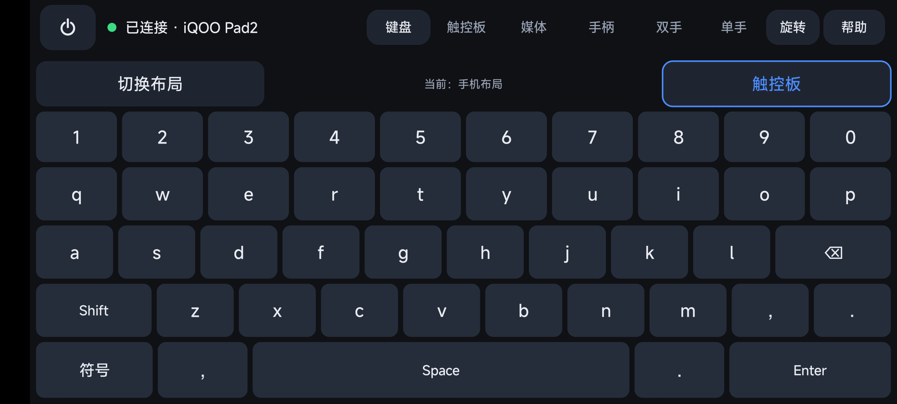 | 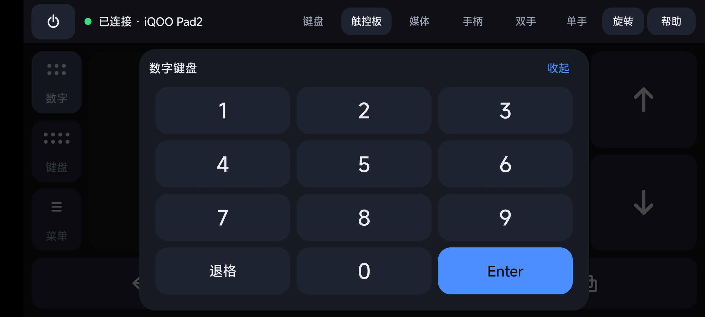 |

| 媒体 | 手柄 | 双手模式 |
|---|---|---|
| 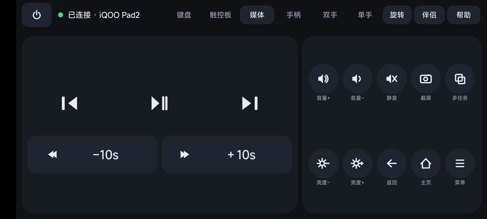 | 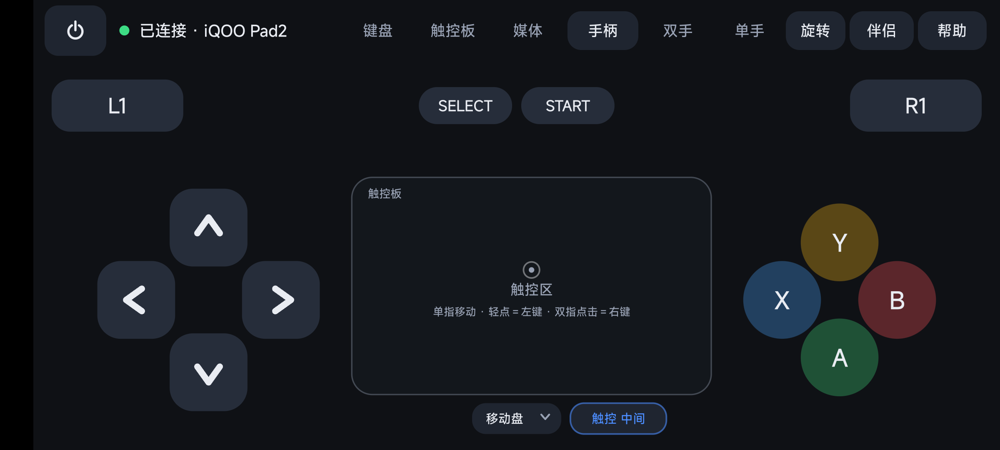 | 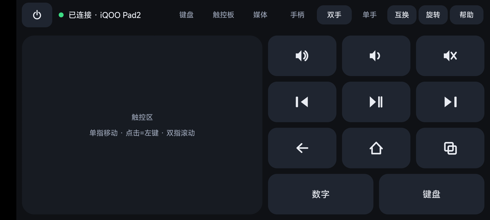 |

| 单手遥控台 | 单手拇指键盘 | WiFi 伴侣（手机端） |
|---|---|---|
| 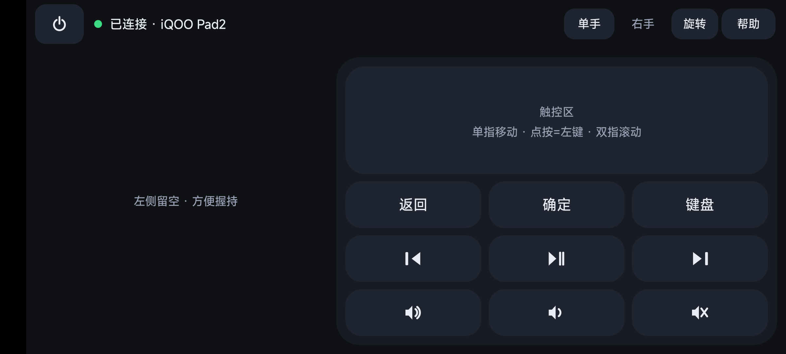 | 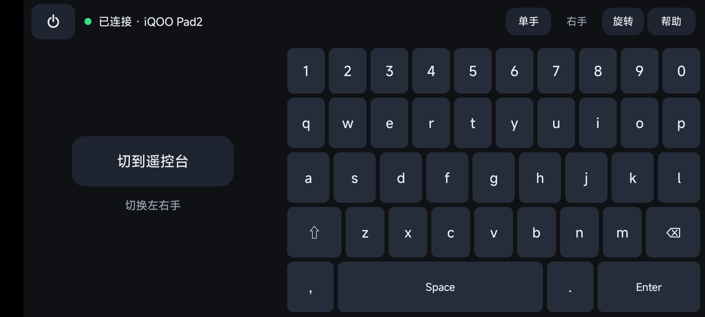 | 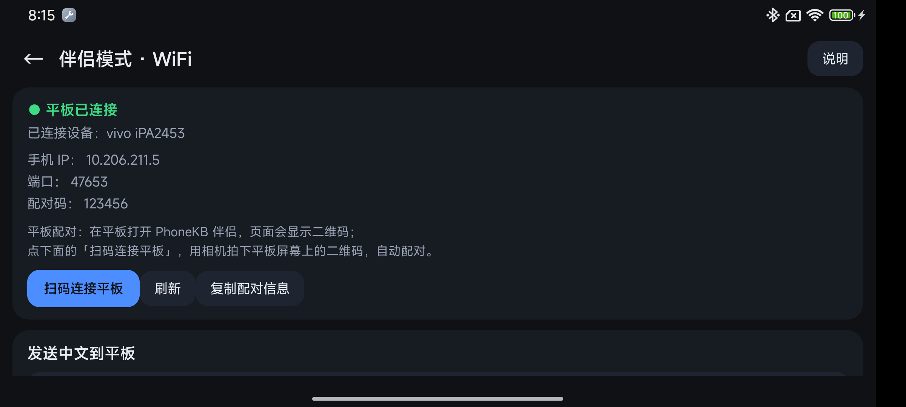 |

| 竖屏键盘 | 竖屏触控板 | 自适应 · 窄屏「更多」 |
|---|---|---|
| 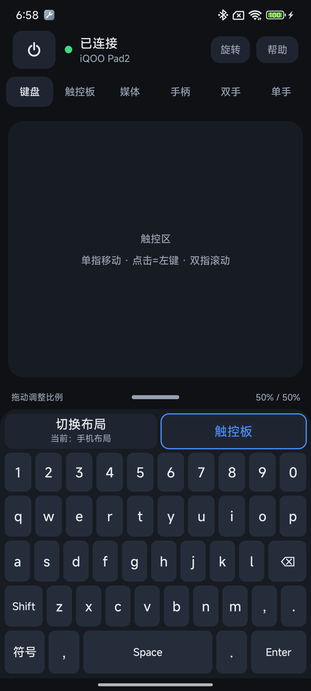 | 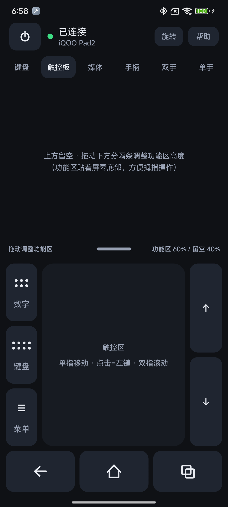 | 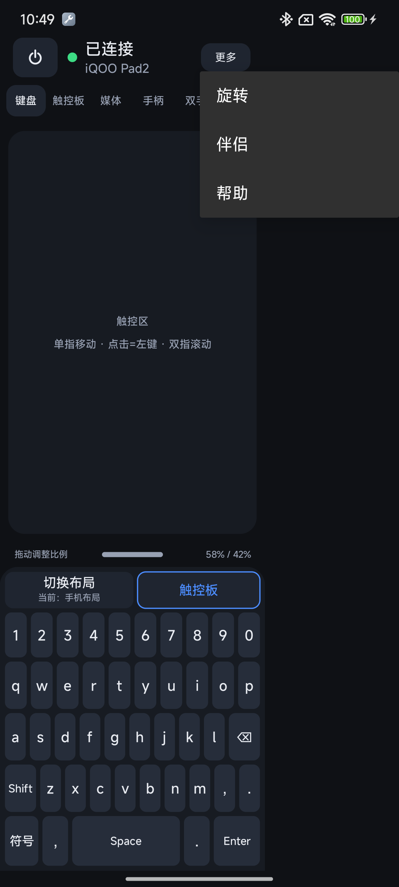 |

更多截图见 [docs/screenshots/](docs/screenshots/)。

## 下载与安装

从 [Releases](https://github.com/linxun314/phonekb/releases/latest) 下载：

| 文件 | 装在哪 | 说明 |
|---|---|---|
| `PhoneKB-x.y.z.apk` | **手机** | 主 App，全部键鼠/媒体/手柄功能 |
| `PhoneKB-Companion-x.y.z.apk` | **平板**（可选） | 伴侣 App，只在需要中文输入/剪贴板时安装 |

安装提示：Android 13+ 首次安装需允许「此来源的应用」；手机端首次运行请允许通知权限（前台服务保活，否则后台会被系统回收导致蓝牙断开）。

## 快速开始

1. **手机装 PhoneKB 并打开**，顶部状态显示「等待配对 / 已连接」
2. **点右上角「配对」**，按提示让手机蓝牙处于可被发现状态
3. **在被控设备上配对**：打开平板/电脑的蓝牙设置 → 搜索手机蓝牙名称 → 配对；回到 App 看到「**已连接 · 设备名**」即可使用

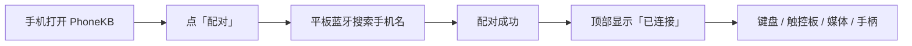

**连上了但按键没反应？** 在手机蓝牙设置里删掉该设备的配对，再从 App 的配对引导重新走一次（HID 需要正确的配对流程）。更多排错见 [docs/使用说明.md](docs/使用说明.md)。

## WiFi 伴侣（可选，解决中文输入）

蓝牙 HID 只能发送键盘键码，汉字要靠被控端自己的输入法。「手机打中文、平板直接出汉字」请用伴侣：

1. 平板安装并打开 **PhoneKB 伴侣**，页面显示配对二维码
2. 手机 App → 右上角 **伴侣** → **扫码连接平板**（也可手动填 IP / 端口 / 配对码）
3. 平板自动连回手机，伴侣页显示「平板已连接」
4. 在「发送中文到平板」框输入中文 → **发送到平板**，文字会写进平板当前输入框；也可把手机剪贴板一键发过去
5. 平板上复制的文字会自动同步回手机剪贴板

> 平板端需要开启**无障碍服务**（Android 安全限制，重启/被清理后需手动再开一次）。建议同时开「电池不限制」「允许自启动」。

**用手机调平板亮度**：媒体页的「亮度 −/＋」在多数 Android 平板/电视盒子上有效；但 iQOO / vivo 等部分平板会完全忽略蓝牙亮度键码。这类平板请在伴侣页点「**授予「修改系统设置」权限**」授权一次，之后手机点亮度键就会走 WiFi 直接改平板系统亮度（会先切到手动亮度，步长约 8%）。

## 手势与快捷键速查

| 触控板 | 操作 |
|---|---|
| 移动光标 | 单指滑动 |
| 左键 | 单指点击 |
| 右键 | 双指点击 |
| 中键 | 三指点击 |
| 滚动 | 双指上下滑动，或按住右侧 ↑/↓ |
| 拖拽 | 按住底部「左键」再用触控区移动 |

| 键盘 | 说明 |
|---|---|
| 切换布局 | 顶部「切换布局」：手机布局 / 电脑布局 |
| 符号 | 手机布局左下角「符号」页，`ABC` 返回 |
| 快捷键 | Ctrl+C / Ctrl+V / Ctrl+X / Ctrl+A / Alt+Tab 专用键 |
| 浮层键盘 / 数字键盘 | 触控板页左侧「键盘」「数字」按钮随时呼出 |

## 兼容性

| 角色 | 要求 |
|---|---|
| 手机（控制端） | Android 9（API 28）及以上；系统保留 **Bluetooth HID Device profile**（少数厂商 ROM 会屏蔽，App 会检测并提示） |
| 被控端 | 支持蓝牙键盘/鼠标的设备：Android 平板/手机、Windows、macOS、Linux；iPadOS 13+ 理论支持（未实测） |
| 界面适配 | 以 393dp 为基准自动缩放，约 320–480dp 宽度、系统字体 0.85–1.3 倍下均可用 |
| WiFi 伴侣 | 平板 Android 9+，安装伴侣 APK 并开无障碍；手机与平板在同一 WiFi（手机热点也行） |

## 为什么不用投屏 / 远程桌面？

| 方案 | 延迟 | 被控端安装 | 能打字/用快捷键 | 适合场景 |
|---|---|---|---|---|
| **PhoneKB（蓝牙 HID）** | 极低（HID 事件） | **不需要** | 系统级键盘，任何 App 都能输入 | 打字、快捷操作、演示、躺床操作 |
| scrcpy / 无线投屏 | 中（视频编码） | 需要开 USB/无线调试 | 部分 | 需要看屏幕、精细操作 |
| 远程桌面类 App | 较高 | 两端都装 | 部分 | 完整桌面操控 |

PhoneKB 不传输画面，只把手机当外设，所以延迟低、被控端干净；需要看屏幕时仍可配合投屏使用。

## 隐私与权限

- 手机端权限：**蓝牙**（HID 必需）、**网络**（WiFi 伴侣，仅局域网）、**通知**（前台服务保活）；不需要存储、通讯录、位置
- 扫码使用系统相机 App，**不申请相机权限**
- WiFi 伴侣只在同一局域网内直连（默认端口 `47653`），配对使用一次性配对码；数据不经过任何服务器
- 不采集、不上传任何数据，所有配置只保存在本机 SharedPreferences

## 构建

### Gradle（Android Studio 用户）

```bash
./gradlew assembleDebug        # Windows: gradlew.bat assembleDebug
```

产物：`app/build/outputs/apk/debug/app-debug.apk`（手机端）、`companion/build/outputs/apk/debug/companion-debug.apk`（伴侣）。需要 JDK 17+、Android SDK Platform 36。

### 命令行（不装 Android Studio，Windows）

```powershell
powershell -ExecutionPolicy Bypass -File tools/build.ps1 -Clean -Module app -VersionName 0.20.0 -VersionCode 26
powershell -ExecutionPolicy Bypass -File tools/build.ps1 -Clean -Module companion -VersionName 0.4.0 -VersionCode 4
```

脚本直接调用 `aapt2 → javac → d8 → zipalign → apksigner`，产物在 `build/`。平板没有 adb 时，可用 `node tools/serve-apk.js` 起一个局域网下载页（端口 8000）。

### GitHub Actions

仓库自带 CI（[build.yml](.github/workflows/build.yml)），push / PR 自动构建两个 debug APK 并上传 Artifacts。发布流程见 [docs/发布指南.md](docs/发布指南.md)。

## 项目结构

```
app/src/main/java/com/phonekb/          手机端
  MainActivity.java      页面框架、顶栏、浮层、设置记忆
  HidManager.java        BluetoothHidDevice 封装：注册、连接、报文发送
  HidConstants.java      HID Report Descriptor 与键值常量
  KeyboardView.java      键盘页（两套布局 + 符号页）
  TouchpadView.java      触控板页（手势 / 滚动 / 按键）
  PadController.java     触控板手势判定
  ControlPadView.java    浮层数字键盘 / 键盘 / 触控板
  MediaView.java         媒体页
  GamepadView.java       手柄页
  TwoHandView.java       双手模式
  OneHandDeckView.java   单手模式
  CompanionActivity.java WiFi 伴侣页（扫码 / 中文上屏 / 剪贴板 / 日志）
  CompanionBridge.java   WiFi 通道服务端（TCP，一行一个 JSON）
  KeepAliveService.java  前台保活服务
  ChromeBar.java / Ui.java / Icons.java  顶栏折叠、自适应尺寸、自绘图标
companion/src/main/java/com/phonekb/companion/   平板伴侣
  MainActivity.java      配对二维码 / 连接状态 / 收发日志
  LinkService.java       通道客户端 + 配对监听 + 保活
  InjectorService.java   无障碍服务：文字写入当前输入框
tools/build.ps1          无 IDE 构建脚本
tools/serve-apk.js       局域网 APK 下载页（平板装伴侣用）
docs/                    文档与截图
```

## 技术实现

- 手机端用 `BluetoothHidDevice`（API 28+）注册复合 HID 设备，一个 Report Descriptor 内 4 个 Report ID：
  - 键盘：8 字节，6KRO + 修饰键
  - 鼠标：按键 + 相对位移 + 滚轮
  - Consumer Control：16 位 usage（媒体、音量、浏览器/主页/返回等）
  - Gamepad：hat + 16 个按键
- 全部 UI 为自绘 `View`（Canvas），蓝牙功能**无第三方依赖**；自适应缩放、顶栏折叠也由自绘逻辑完成
- 前台服务保活，避免 Activity 被回收导致 HID 静默注销；注册失败自动重试
- WiFi 伴侣：手机端 TCP 服务端（默认端口 **47653**），平板端客户端，协议为「一行一个 JSON」；配对时平板监听 **47654** 并展示二维码，手机扫码后把 `{ip,port,token}` 交给平板，平板再主动连回手机
- 平板端用 `AccessibilityService` 把文字写入焦点输入框并同步剪贴板

## 已知限制

- **中文输入**：蓝牙 HID 只发键码，汉字需要被控端自己的输入法；手机打中文请用 WiFi 伴侣
- **WiFi 伴侣依赖无障碍**：Android 不允许 App 自动开启无障碍，平板重启/被清理后需手动再开一次
- **伴侣只解决文字/剪贴板**：键鼠操作仍走蓝牙 HID
- **光标外观**：光标由被控端系统绘制，蓝牙鼠标只能发相对位移，无法改形状/大小；可在平板「辅助功能 / 鼠标」里调指针大小
- 少数手机 ROM 禁用 HID Device profile，只能当主机用
- 同一时间只能有一个 App 注册 HID 外设，装了其它 HID 类 App 需先停用

## 常见问题

**Q：手机和平板需要连同一个 WiFi 吗？**
A：只有用 WiFi 伴侣时需要；纯蓝牙 HID 不需要。

**Q：平板需要 root 吗？手机需要 root 吗？**
A：都不需要。被控端甚至不需要装 App。

**Q：为什么平板打不出中文？**
A：蓝牙 HID 只能发送键码（相当于外接键盘），系统输入法不会把拼音转成汉字。用 WiFi 伴侣可把手机输入的中文直接写进平板输入框。

**Q：能控制 iPhone / iPad 吗？**
A：iPadOS 13+ 支持蓝牙键盘鼠标，理论上可配对使用（本仓库主要在 Android 平板实测，Apple 设备未实测）。

**Q：能反向，用平板控制手机吗？**
A：不能。PhoneKB 的方向固定：手机是外设，被控端是主机。

**Q：一次能连几台设备？**
A：HID 同一时间只保持一条连接；换设备时在系统蓝牙里切换即可，配对关系会保留。

**Q：为什么不用 scrcpy 那种方案？**
A：那是「投屏 + 注入」，需要被控端开调试；PhoneKB 追求被控端零安装、系统级键盘、低延迟。两者可以互补。

## Roadmap

- [ ] WiFi 伴侣：语音输入上屏、自定义光标浮窗（大小/颜色）、WiFi 与蓝牙自动切换
- [ ] HID 绝对触控（数字化仪）模式：触控板 1:1 映射平板屏幕，点哪打哪
- [ ] 指针速度 / 滚轮速度 / 反向滚动等设置
- [ ] 手柄摇杆、扳机键
- [ ] USB 通道（ADB 注入）

## 参与贡献

Issues / PR 都欢迎。提交前请先看 [docs/需求与进展.md](docs/需求与进展.md) 与 [CHANGELOG.md](CHANGELOG.md)。

## 文档

| 文档 | 内容 |
|---|---|
| [docs/使用说明.md](docs/使用说明.md) | 完整安装、配对、各平台注意事项、排错、卸载 |
| [docs/调试参数.md](docs/调试参数.md) | `adb am start` 调试参数（切页、模拟窄屏、浮层等） |
| [docs/需求与进展.md](docs/需求与进展.md) | 需求、已完成能力、待办清单 |
| [docs/验证记录.md](docs/验证记录.md) | 真机验证记录（Redmi K40 + iQOO Pad2） |
| [docs/发布指南.md](docs/发布指南.md) | 建仓库、构建、打 tag、发布 Release |
| [CHANGELOG.md](CHANGELOG.md) | 版本更新日志 |

## 致谢

实现前调研并参考了这些开源项目的行为与思路（**本仓库代码为独立实现，未复制任何 GPL/AGPL 代码**）：

- [jqssun/android-bt-remote](https://github.com/jqssun/android-bt-remote)（GPLv3，界面/交互参考）
- [arnav-kr/Bluke](https://github.com/arnav-kr/Bluke)（AGPLv3）
- [raghavk92/Kontroller](https://github.com/raghavk92/Kontroller)
- [darusc/Mousedroid](https://github.com/darusc/Mousedroid)

## License

[Apache-2.0](LICENSE) © linxun314

---

如果这个项目对你有用，欢迎点一个 ⭐ Star，让更多人看到。
